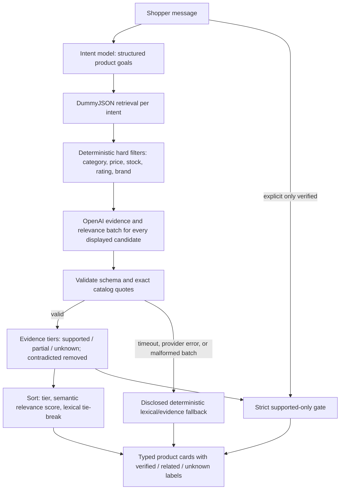

# Bazak AI Agent Commerce

A conversational product-discovery prototype built with Next.js, TypeScript, the Vercel AI SDK, and the supplied DummyJSON Products API. A shopper can ask for one or several products in English, refine the request, see catalog-backed React product cards, and resume saved conversations.

## Run locally

Use Node.js 22.13 or newer and npm:

```bash
npm ci
npm run dev
```

Open `http://localhost:3000`. Conversation data defaults to `var/data/commerce.sqlite`; set the server-only `BAZAK_DATABASE_PATH` to use a different SQLite file.

For correlated server-side debugging during `npm run dev`, opt into bounded structured logs:

```bash
BAZAK_SERVER_DIAGNOSTICS=summary npm run dev
# Explicitly include a redacted, 500-character prompt and trusted product titles:
BAZAK_SERVER_DIAGNOSTICS=verbose npm run dev
```

Diagnostics are off by default and always off when `NODE_ENV=production`. Every line starts with `bazak_server_diagnostic` and contains a hashed per-turn `traceId`. Summary mode records prompt length/language/hash, interpreted intent structure, follow-up target, search filters, product IDs/counts and error codes; it does not record raw shopper text, model prose, product titles, catalog descriptions, credentials or provider envelopes. Verbose mode is development-only, bounded and secret-redacted, but may still contain shopper wording, so enable it only for a controlled local reproduction.

Conversation memory is server-owned and versioned. Each completed turn atomically advances a compact `conversation_state` projection containing up to eight active intents, current focus when unambiguous, the last explicit operation, and the displayed result order. Existing databases migrate additively: no message, turn, intent, or product snapshot is rewritten, and an older conversation receives its first projection when its next turn completes. The intent-planning model still receives only the current shopper prompt and bounded active intent state, not the full transcript.

Code rollback to a pre-v6 application requires stopping all writers, backing up the SQLite file, and removing only the migration marker with `BEGIN IMMEDIATE; DELETE FROM schema_migrations WHERE version = 6; COMMIT;`. Leave `conversation_state` and `decision_events` in place so no v6 data is discarded. The older application then ignores those additive tables. Migration 6 uses `IF NOT EXISTS`, so a later roll-forward records version 6 again without replacing the retained rows.

Displayed ordinal references such as “show me the second one” are resolved deterministically from persisted display order when exactly one product group is in scope. Selection-only turns bypass planning. For compound cheaper/USD-budget or separately named-product turns, the server validates the bounded reference against persisted results and enforces the referenced intent/category after planning; additive product clauses keep the exact selected product visible. “Make the second one cheaper” returns only products priced strictly below that saved product and excludes the product itself, while any tighter budget remains active. Comparative `cheaper` without a selected product asks for an explicit maximum price instead of pretending that sorting is a price comparison. The adjective `cheap` remains price ordering. An ambiguous reference is not guessed.

The safe default, `LLM_PROVIDER=disabled`, makes shopping requests fail closed. For the hosted boundary, configure these server-only values in an ignored environment file:

```text
LLM_PROVIDER=openai
LLM_API_KEY=...
LLM_MODEL=gpt-5.4-mini
LLM_BASE_URL=https://api.openai.com/v1
```

The local testing branch also accepts `LLM_PROVIDER=litellm` with an explicitly configured OpenAI-compatible base URL and model. Credentials must never use a `NEXT_PUBLIC_*` name or be committed. The application does not silently switch providers, endpoints, or models.

## What is implemented

- A single shopper-facing agent uses structured model output to extract up to eight independent intents. The live path does **not** let the model call catalog tools directly: application code resolves categories, retrieves candidates, filters, ranks, persists, and renders them deterministically.
- System prompts live in `src/lib/ai/prompts`; shopper text and prior intent state are separate typed data.
- Explicit USD budgets, rating, stock, brand, category, and ordering constraints are scoped per intent. ILS/NIS/₪ budgets are not treated as USD.
- Unsupported semantics such as brand exclusion, minimum prices, contradictory bounds, and shared multi-product budgets fail honestly instead of being silently inverted or discarded.
- Explicit catalog-proof requests use a fail-closed evidence gate. Known capabilities use reviewed synonyms; unseen phrases such as “satellite calling” are extracted from proof language and matched only against trusted product title, description, or tags. Ordinary descriptive browsing remains ranking context rather than an automatic hard filter.
- Product facts come only from schema-validated DummyJSON responses. Model text cannot introduce a product, product ID, HTML, or executable UI.
- Conversations, messages, turns, intents, results, and product snapshots are written to SQLite before/after execution. Refresh, a second client using the conversation URL, and the saved-conversation list read that server state.
- Accepted work continues in the current server process if the browser disconnects. A bounded status poll reconciles a client timeout with the persisted terminal result without submitting the operation twice.
- Product results render in stable batches of five with independent multi-intent groups, scoped empty/failure states, keyboard-accessible controls, and responsive layouts.

The repository also contains a separate experimental commerce-agent runtime under `src/lib/agent/`. Its schema-validated tool loop is tested, but it is not the live `/api/orchestrate` execution path.

## Architecture and trade-offs

The request path is:

1. `POST /api/orchestrate` validates and accepts a stable conversation/turn identity.
2. SQLite records the queued turn and shopper message before model/catalog work starts.
3. The model returns a structured intent plan. Provider-generated tag guesses remain ranking language rather than exact catalog filters.
4. Deterministic code resolves each product term against the current trusted category list.
5. Known categories use `GET /products/category/{slug}?limit=100&skip=N` until the bounded category result is complete. Results are deduplicated by product ID, hard-filtered, and ranked. Unknown categories may use `GET /products/search?q=...&limit=20&skip=0` or ask one focused category question.
6. Product details used to preserve earlier results are revalidated with `GET /products/{id}`. Category discovery uses `GET /products/category-list`.
7. One terminal result and its ordered product snapshots are persisted, then returned as typed application-owned UI.

Category-first retrieval was chosen because phrases such as “phone for photography” describe a use case, not necessarily a product title. Searching that full phrase first can incorrectly discard every smartphone. Ranking uses lexical overlap across trusted title, tags, category, brand, and description, blended with a bounded rating signal; explicit constraints remain hard filters.

For explicit feature-proof requests, exact catalog evidence is deliberately stricter than general relevance. Curated capabilities can use reviewed synonyms, while an unseen feature uses conservative lexical evidence and returns an honest empty result when the catalog does not establish it. The rejected shortcut was treating semantic similarity as proof: “satellite SOS” may be related to “satellite calling” without proving voice-call support.

The local-only `local/semantic-evidence-shadow` experiment adds a model-assisted relevance and evidence stage after deterministic hard filtering. It returns `supported`, `partial`, `contradicted`, or `unknown`, bounded confidence, a relevance score, and exact title/description/tag quotes. Application code verifies every quote. Normal results show verified matches first, related-but-not-verified products next, and unknown products last; contradicted products are removed. “Only verified” requests remain strict. Provider failure or invalid evidence falls back to the existing deterministic behavior. This branch uses the existing assignment OpenAI configuration, remains unpushed, and still needs independent live evaluation.



The intent model decides what to search for; it does not author products. DummyJSON remains the product source. The second model evaluates only retrieved catalog text and cannot bypass hard filters. Its score influences order only within an evidence tier; ties preserve the deterministic baseline order, which is lexical relevance normally and price ascending for an explicit cheaper request. Exact evidence determines whether a product may be called verified.

The first independent 15-case live A/B run found that silent fallback, narrow strict wording, contextual negation, category synonyms, and a 12-product evaluator cap could undermine that contract. The remediation keeps strict requests fail-closed, labels only evaluated products, discloses fallback, derives global copy from actual card tiers, and uses narrow literal-evidence consistency so direct terms such as `slim` cannot be rejected while related terms such as `satellite SOS` still do not prove satellite calling.

The second live retest isolated one remaining strict failure: the evidence extractor passed an expanded planner query instead of the literal adjective in “documented slim laptops.” The experiment now extracts that adjective directly, can combine exact whole-token evidence from multiple trusted fields, and handles the reviewed daytime-fresh negative preference only when both unwanted terms are literally established. Whole-token matching prevents substrings such as `red` inside `Predator` from becoming false proof.

Two alternatives were rejected for this assignment:

1. **A multi-agent planner/searcher/writer pipeline.** It adds handoff state, latency, failure modes, and inconsistent context without improving the small catalog task. One structured plan plus deterministic per-intent work is easier to inspect and test.
2. **Model-authored products or model-authored HTML.** It could produce fluent answers, but it breaks the assignment’s catalog grounding and composable React UI goals. Only validated catalog objects reach product components.

A third production alternative—managed durable storage plus a queue/worker lease—would survive process and host failure. SQLite was chosen for a reviewable local prototype, not as a claim of distributed durability.

## Ambiguity, off-catalog requests, and failures

Missing optional preferences do not block a known category. The app asks one clarification only when the category is unresolved or the result is materially empty/split. In a multi-intent request, an unaffected sibling can still complete. Requests such as flights receive a bounded explanation and never reuse stale product results.

An additive prompt such as “Also show me perfumes under $100” preserves the prior product topic as a sibling. A later category-free “Show me cheaper options” first asks which active topic to refine, then asks for a maximum price because no product comparison baseline was selected. A named request such as “Show me cheaper perfumes” skips the category question but still asks for that price threshold. The adjective `cheap` continues to request price-ascending ordering without a comparison claim.

Transient provider/catalog retry infrastructure supports five total attempts, but the current live orchestrator applies it only to an explicit retry of a failed intent. Initial provider and catalog operations are not yet uniformly wrapped, and completed executions currently persist an empty `toolRuns` list. Therefore the authored five-attempt/attempt-observability target in `outputs/SPEC.md` is **deferred**, not an employer requirement or a completed feature.

SQLite errors fail the request rather than falling back to browser-only state:

- **Disk full/read-only/locked:** the write fails; the UI reports an unavailable request and must not claim it was saved.
- **Corrupt database/schema:** startup or the affected read/write fails closed. Recovery requires restoring a known-good database or intentionally starting a new one; the app does not auto-repair unknown corruption.
- **Database cleared during a conversation:** a later status/read returns “not found.” The client offers a new conversation rather than reconstructing trusted products from model text.
- **Server restart during work:** startup recovery marks stale queued/running work honestly; SQLite alone cannot continue the interrupted computation.

## Verification

```bash
npm run check
npm run build
npm run test:e2e
npm start
```

`npm run check` runs lint, generated Next.js route types, TypeScript, and Vitest unit/integration tests. The deterministic suites cover schema boundaries, ranking, category-first and multi-intent behavior, USD/ILS scoping, cheap sorting, five-item pagination, retry classification, persistence/idempotency, refresh/resume, timeout recovery, prompt injection, long conversations, and desktop/mobile layout.

The evidence suite also contrasts explicit proof requirements, unseen feature phrases, positive trusted-text matches, ordinary descriptive browsing, multilingual/multi-intent scoping, and false-positive controls. The latest bounded live report is recorded under `outputs/QA_OPEN_VOCAB_LIVE_RETEST_REPORT_2026-10-31.md`; it is evidence for that sampled provider run, not a guarantee about every future model response.

Playwright intercepts `/api/orchestrate` for deterministic browser journeys. That proves UI and recovery behavior, not the configured model provider or live DummyJSON availability. Provider-realistic checks are a separate, explicitly budgeted local review; credentials are not stored in the repository. Tests do not currently prove destructive database corruption recovery, real disk-full behavior, a full accessibility audit, distributed concurrency, or consistent quality across many live model samples.

### Live behavior evaluation

The opt-in live evaluation layer is deliberately separate from `npm test`, `npm run check`, and Playwright:

```bash
# Uses only the configured real provider and the live DummyJSON catalog.
# It never substitutes either boundary with a mock.
npm run eval:live
```

The harness creates and verifies a unique `BAZAK_DATABASE_PATH` under the operating-system temporary directory. Each turn reopens that SQLite file and records the shopper input, interpreted decision events, memory before/after, active focus, persisted catalog arguments, product IDs/prices, response, objective assertion reasons, persistence evidence, independent judge result, timing, and available usage. Artifacts default to the operating-system temporary directory under `bazak-live-eval-artifacts/<run-id>/`; set `BAZAK_EVAL_ARTIFACT_DIR` to retain them elsewhere. Do not point it at a directory containing user data.

Results are `PASS`, `FAIL`, or `INCONCLUSIVE`. Objective failures are immutable and an LLM judge cannot override them. The judge is an independently executed assessment, but currently uses the same configured provider/model and is therefore not provider-independent. Missing credentials, provider/catalog unavailability, incomplete boundary evidence, or insufficient judge evidence is `INCONCLUSIVE`; the harness does not silently fall back. Both `FAIL` and `INCONCLUSIVE` make `npm run eval:live` exit nonzero, so only a complete `PASS` is green CI evidence. `callCounts` records application turns, actual captured catalog HTTP calls, and judge calls. The application runtime does not currently expose exact provider request or token counts, so the summary states that limitation rather than guessing.

`npm run test:eval-harness` tests the harness mechanics without making live calls. Scenarios live under `evals/live/scenarios.ts` and cover natural multi-turn refinement, ambiguous interruptions and clarification, topic switches, implicit ordinal references, paraphrases, and adversarial catalog-grounding attempts. This harness was based on commit `2435b86`; it depends only on the public orchestration/persistence interfaces, so later behavior changes can be evaluated without modifying product logic.

## Original assignment versus project choices

The employer request requires a local AI shopping experience using the supplied DummyJSON widgets/API, natural-language and multi-intent shopping, composable product UI, conversation refresh/new/list/resume behavior, tests/evaluation spanning input → retrieval → rendering, setup/architecture documentation, at least two rejected alternatives, limitations, and a “what I would change with another week” reflection. OpenAI mini/nano models were allowed, not mandated.

SQLite, the Vercel AI SDK, GPT-5.4-mini, the exact retry count, persisted tool attempts, a local LiteLLM option, and the timezone attached to the planning deadline are project decisions or assumptions. `outputs/SPEC.md` records both the employer boundary and those authored targets; incomplete authored targets are not presented as completed employer requirements.

Cart, checkout, authentication, deployment, and production job infrastructure are outside the current submission scope. The supplied OpenAPI reference remains unchanged at `docs/dummyjson_products_openapi.yaml`.

## What I would change with another week

> Candidate reflection for the submitter to review and personalize before delivery.

I would first replace process-bound execution and local SQLite with a durable database and queued worker lease, because recovery at the browser’s 30-second boundary exposed how important authoritative job state is. Next I would add fault-injection tests for initial provider/catalog retries and persist every attempt, then run a small labeled relevance set across ambiguous, multi-intent, and empty-result prompts to tune ranking with evidence rather than intuition. Finally, I would run a full keyboard/screen-reader audit and add deployment-specific storage and observability checks. I would keep the catalog-first trust boundary and typed React rendering: those constraints prevented fabricated products even when the prompt asked for one.

For semantic evidence, I would evaluate a separate model-assisted judge only after building a labelled set of supported, contradicted, and unknown claims. The judge would return exact catalog spans and confidence, but confidence or similarity alone would never count as proof. OpenAI and the existing local LiteLLM/Ollama-compatible route are both viable evaluation backends; the deterministic lexical gate remains the safe baseline and fallback.

## Conventions

Domain code and reusable components use named exports. Next.js route pages/layouts use framework-required default exports. Automated tests live in `tests/`; deterministic catalog fixtures and their provenance are in `tests/fixtures/catalog/`.
